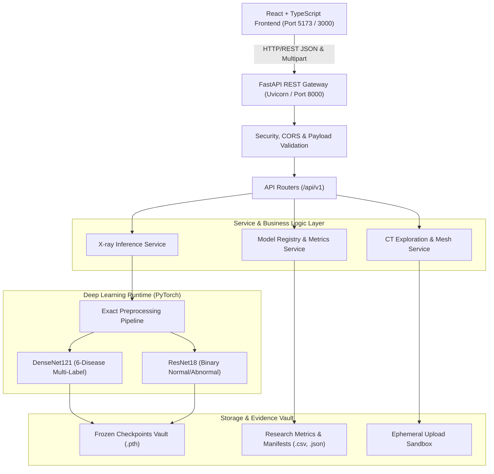
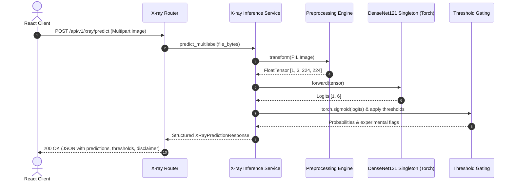

# LungVision AI — System Architecture Specification

**Document Version:** 1.1.0  
**Status:** Approved / Active Governance  
**Author:** Staff Backend Architect & MLOps Lead  
**Governing Skill:** Gravitas Engineering Reliability Runtime  
**Updated:** 2026-11-12  

---

## 1. System Overview & Context

LungVision AI is structured as a decoupled, multi-tier system separating deep-learning research models, statistical evaluation registries, an asynchronous Python service layer (FastAPI), and an upcoming React + TypeScript frontend.



---

## 2. Existing vs. Proposed Architecture

### 2.1 Existing Repository Layout (Audit Findings)
The initial codebase consisted of disconnected research artifacts, training checkpoints, evaluation summaries, and loose scripts:
- `lungvision_disease_classification/`: Multi-label NIH DenseNet121 training checkpoints and full dataset manifests.
- `lungVision/`: Evaluation outputs, calibration tables (`nih_validation_thresholds.csv`), and CheXpert external evaluations.
- `LungVision_AI_Final_Research_Bundle/`: Frozen research evidence bundle, VinDr-CXR external validation, Grad-CAM audits, and ResNet18 checkpoints.
- `LungVision_AI_Model_Registry/`: Formal model registry configuration for binary ResNet18 models.
- `lungvision_phase2_*/`: Extensive preprocessing audits, padding comparisons, and pixel intensity evaluations.

### 2.2 Proposed Backend Architecture (`backend/`)
The new architecture consolidates these capabilities into an enterprise-grade, clean, maintainable backend directory structure:

```text
backend/
├── app/
│   ├── __init__.py
│   ├── main.py                  # Application entry point, lifespan, OpenAPI setup
│   ├── config.py                # Pydantic BaseSettings, environment configuration
│   ├── api/
│   │   ├── __init__.py
│   │   ├── router.py            # Aggregated v1 API router
│   │   ├── v1/
│   │   │   ├── __init__.py
│   │   │   ├── health.py        # /health, /ready, liveness/readiness probes
│   │   │   ├── xray.py          # /xray/predict (DenseNet121 & ResNet18)
│   │   │   ├── ct.py            # /ct/upload, /ct/{id}/metadata, /ct/{id}/mesh
│   │   │   ├── models.py        # /models, /models/{id} registry metadata
│   │   │   └── research.py      # /research/metrics, historical benchmark data
│   ├── core/
│   │   ├── __init__.py
│   │   ├── errors.py            # Custom exceptions and RFC 7807 error handlers
│   │   ├── security.py          # Input validation, sanitization, path security
│   │   └── logging.py           # Structured JSON/console logging
│   ├── schemas/
│   │   ├── __init__.py
│   │   ├── xray.py              # Pydantic models for X-ray prediction requests/responses
│   │   ├── ct.py                # Schemas for CT metadata, slices, and mesh descriptors
│   │   ├── models.py            # Schemas for model registry entries
│   │   └── common.py            # Standard response wrappers and error schemas
│   └── services/
│       ├── __init__.py
│       ├── model_loader.py      # Checkpoint singleton loader with SHA-256 verification
│       ├── preprocessing.py     # Verified transformation pipeline
│       ├── xray_service.py      # Inference execution, sigmoid scoring, threshold gating
│       ├── ct_service.py        # Unified orchestrator facade for CT services
│       ├── registry_service.py  # Audit artifact ingestion and benchmark metrics delivery
│       └── ct/                  # Modular CT processing sub-package
│           ├── __init__.py
│           ├── geometry.py      # Physical-to-voxel math & atol=1e-3 geometry validation
│           ├── loader.py        # SimpleITK volume loader & calibrated reference volume
│           ├── slice_service.py # Multi-planar slices with HU windowing & contour overlays
│           ├── annotation_service.py # LUNA16 annotation mapping & proximity filtering
│           ├── mesh_service.py  # 1-voxel padded marching cubes & Trimesh quality audits
│           └── measurement_service.py # High-precision voxel-to-milliliter lung volumetry
├── tests/
│   ├── __init__.py
│   ├── conftest.py              # TestClient fixtures, synthetic test images
│   ├── test_health.py           # Health and readiness tests (3 tests)
│   ├── test_xray_inference.py   # Multi-label and binary inference verification (4 tests)
│   ├── test_ct_service.py       # CT geometry, slices, annotations, meshes & volumetry (11 tests)
│   ├── test_model_registry.py   # Metadata endpoints and artifact integrity tests (4 tests)
│   └── test_security_validation.py # File validation, size limits, and error handling (5 tests)
├── requirements.txt             # Production and testing dependencies
├── .env.example                 # Config template
└── README.md                    # Backend run & developer guide
```

---

## 3. Machine Learning Inference Pipeline

### 3.1 6-Disease DenseNet121 Pipeline
The multi-label classifier is based on `torchvision.models.densenet121` with a custom linear head (`in_features=1024, out_features=6`).



### 3.2 Preprocessing Integrity Architecture
To eliminate train-inference skew, the preprocessing pipeline implements the exact transformations verified during training:
1. **Mode Normalization:** Converts any uploaded image (Grayscale `L`, Palette `P`, or Alpha `RGBA`) to 3-channel standard `RGB`.
2. **Spatial Rescaling:** Direct bilinear interpolation resize to exactly $224 \times 224$ pixels (`transforms.Resize((224, 224))`).
3. **Tensor Normalization:** Converts range to $[0.0, 1.0]$ via `ToTensor()` followed by `Normalize(mean=[0.485, 0.456, 0.406], std=[0.229, 0.224, 0.225])`.

### 3.3 Model Output Ordering & Frozen Thresholds
The output tensor indices map strictly to the verified label list:
- Index 0: `Cardiomegaly` (Threshold: `0.9501953125`)
- Index 1: `Edema` (Threshold: `0.876953125`)
- Index 2: `Consolidation` (Threshold: `0.73291015625`)
- Index 3: `Pneumonia` (Threshold: `0.7529296875`)
- Index 4: `Atelectasis` (Threshold: `0.74951171875`)
- Index 5: `Pneumothorax` (Threshold: `0.58251953125`)

---

## 4. 3D CT Exploration Architecture

### 4.1 Boundary & Capabilities
In strict adherence to project rules and research facts:
- The backend does **not** simulate fake deep-learning CT inferences or claim 2D-to-3D X-ray reconstruction.
- All 3D CT exploration capabilities are ported directly from verified algorithms audited in `backend/lungvision-interactive-viewer.ipynb` (56 cells):
  1. **Volume & Geometry Ingestion:** Support for SimpleITK `.mhd`, `.nii`, `.nii.gz`, and zip archives with tolerance geometry verification (`atol=1e-3`) between CT and segmentation masks.
  2. **Multi-Planar Orthogonal Slicing:** Axial ($XY$), Coronal ($XZ$), and Sagittal ($YZ$) planes with clinical HU window presets (`lung`: -600/1500, `mediastinum`: 50/350, `bone`: 400/1800), alpha-blended segmentation contours (labels 3, 4, 5), and dynamic nodule crosshair projections.
  3. **LUNA16 Annotation Mapping:** Exact physical millimeter-to-voxel continuous mapping, bounding box validation, and slice proximity intersection.
  4. **Watertight Mesh Extraction:** 1-voxel constant zero padded Lewiner marching cubes generating watertight anatomical meshes transformed into physical millimeters.
  5. **Automated Mesh Quality Auditing:** Trimesh topology checks for watertightness, Euler characteristic $\chi = 2$, manifold edges, and volume discrepancy relative to voxel integrals.
  6. **Quantitative Volumetry:** Full-resolution voxel-to-milliliter calculations for Left Lung (label 3), Right Lung (label 4), and Trachea/Airway (label 5) with bilateral symmetry ratios.

### 4.2 Coordinate System Transformations
Array indexing in SimpleITK/NumPy follows $(Z, Y, X)$ order, whereas scanner coordinates follow physical $(X, Y, Z)$ in millimeters relative to isocenter origin:
$$\mathbf{p}_{\text{physical}} = \mathbf{O} + \mathbf{D} \cdot (\mathbf{S} \odot \mathbf{v}_{\text{continuous}})$$
$$\mathbf{v}_{\text{continuous}} = \mathbf{S}^{-1} \odot \left(\mathbf{D}^{-1} \cdot (\mathbf{p}_{\text{physical}} - \mathbf{O})\right)$$
where $\mathbf{O} \in \mathbb{R}^3$ is the physical origin, $\mathbf{D} \in \mathbb{R}^{3 \times 3}$ is the direction cosine matrix, $\mathbf{S} \in \mathbb{R}^3$ is voxel spacing, and $\mathbf{v} = (x, y, z)$ is derived from array indices $(z, y, x)$.

For marching cubes vertices $\mathbf{v}_{\text{zyx}}$, physical vertices are computed via:
$$\mathbf{v}_{\text{xyz}} = \mathbf{v}_{\text{zyx}}[:, [2, 1, 0]]$$
$$\mathbf{v}_{\text{unpadded}} = (\mathbf{v}_{\text{xyz}} - \text{pad}) \cdot \text{step}$$
$$\mathbf{V}_{\text{physical}} = \mathbf{O} + \mathbf{D} \cdot (\mathbf{S} \odot \mathbf{v}_{\text{unpadded}})$$

---

## 5. Storage & Persistence Architecture

### 5.1 Justification: Lightweight Ephemeral Architecture vs. PostgreSQL
- The core requirements for LungVision AI involve stateless real-time inference, research metadata exposure, and transient volume manipulation.
- Introducing a heavyweight PostgreSQL / SQLAlchemy ORM dependency introduces deployment overhead, database migration state, and unnecessary complexity without product necessity.
- **Decision:** Use an in-memory/JSON-backed metadata catalog with ephemeral local disk storage for temporary CT files (cleaned up via scheduled background tasks). This keeps deployment lightweight, zero-dependency, and fully reproducible across developer machines.

---

## 6. Security & Error Handling Boundaries

1. **Input Verification:** File uploads are checked for valid MIME types (`image/png`, `image/jpeg`, `image/webp`, `application/zip`) and file magic headers.
2. **File Size Clamping:** $20\text{ MB}$ limit for 2D images; $150\text{ MB}$ for 3D archives.
3. **Path Traversal Guard:** Uploaded files are assigned cryptographic UUIDs; user filenames are completely decoupled from filesystem paths.
4. **Standard Error Schema:** Uniform error objects featuring `error_code`, `message`, `timestamp`, and `details` compliant with API best practices.
5. **CORS Governance:** Explicit whitelist configured via `.env`, defaulting to common local frontend development ports.

