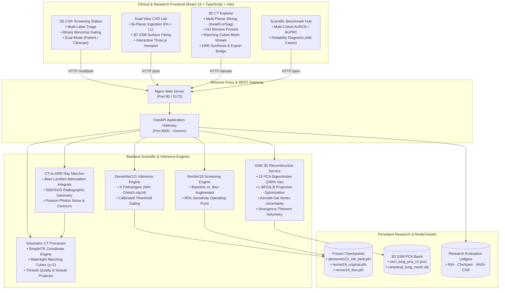

# LungVision AI — Thoracic Imaging Intelligence, 3D Reconstruction & Volumetric Exploration Workstation

[](https://www.python.org/)
[](https://pytorch.org/)
[](https://fastapi.tiangolo.com/)
[](https://reactjs.org/)
[](https://www.typescriptlang.org/)
[](https://threejs.org/)
[](docker-compose.yml)
[-brightgreen.svg)](docs/REGRESSION_TEST_REPORT.md)
[](LICENSE)

**LungVision AI** is an advanced medical imaging research workstation and scientific deep learning platform. It unites **2D chest radiograph pathology triage**, **bi-planar patient-specific 3D lung surface reconstruction (Statistical Shape Modeling)**, **calibrated CT-to-DRR radiographic ray-casting**, and **volumetric 3D computed tomography (CT) multi-planar reconstruction (MPR)** with sub-millimetre LUNA16 pulmonary nodule mapping.

The platform bridges locked, reproducible neural network research artifacts with a modern clinical web interface (React 18, TypeScript, Three.js WebGL) and a high-performance asynchronous REST API (FastAPI, PyTorch, SimpleITK, Trimesh).

---

## 1. System Architectural Overview



---

## 2. Core Functional Capabilities

### A. 2D Chest Radiograph Pathology Screening & Calibration
* **DenseNet121 Multi-Label Triage (`densenet121_nih_6disease`)**:
  * Triage across 6 verified thoracic conditions: **Cardiomegaly**, **Edema**, **Consolidation**, **Pneumonia**, **Atelectasis**, and **Pneumothorax**.
  * Evaluated across **112,120 NIH ChestX-ray14** images with frozen calibration thresholds derived at optimal validation $F_1$ score.
  * Direct bilinear resize to $224 \times 224$, ImageNet normalization, and sub-second CPU/GPU inference.
* **ResNet18 Binary Screening (`original_resnet18` & `blur_augmented_resnet18`)**:
  * Normal vs. Abnormal binary classification trained on IN-CXR and cross-validated on **15,000 VinDr-CXR** images.
  * Dual model deployment compares standard baseline against motion-blur augmented checkpoint for low-dose portable artifact robustness.
  * Calibrated at 90% fixed sensitivity operating thresholds ($\tau_{\text{orig}} = 0.176463$, $\tau_{\text{blur}} = 0.187923$).
* **Dual-Mode Clinical & Patient Explainability**:
  * **Clinician View**: Exact continuous probabilities, frozen thresholds, differential diagnostics, and operational calibration flags.
  * **Patient-Friendly View**: Plain-language explanations answering 6 core clinical questions (What was checked? What did AI observe? What is normal? What are the limitations?).

---

### B. Patient-Specific 3D Lung Statistical Shape Modeling (SSM)
* **Point Distribution Model (PDM) & PCA Formulation**:
  * Canonical watertight lung template mesh $\mathbf{T}_0 = (\mathcal{V}_0, \mathcal{F}_0)$ with **7,652 vertices**, **15,296 triangular faces**, and **975.45 mL** canonical volume.
  * 15 principal variation modes explaining **100.00% of anatomical variance**:
    $$\mathbf{v}(\mathbf{b}) = \bar{\mathbf{v}} + \sum_{m=1}^{M} b_m \sqrt{\lambda_m} \, \mathbf{p}_m$$
  * Eigenmode bounds constrained via Mahalanobis distance penalty: $D_M^2(\mathbf{b}) = \sum_{m=1}^{M} b_m^2 \le 9.0$ ($3\sigma$).
* **Bi-Planar Radiographic Projection Fitting (L-BFGS-B)**:
  * Reconstructs 3D patient anatomy from paired Frontal (PA) and Left Lateral (LL) chest radiographs.
  * Constrained multi-term objective:
    $$\mathcal{L}(\mathbf{b}, s) = w_{\text{front}} \mathcal{L}_{\text{aspect}}^{\text{front}} + w_{\text{lat}} \mathcal{L}_{\text{aspect}}^{\text{lat}} + w_{\text{insp}} \mathcal{L}_{\text{insp}} + w_{\text{reg}} \sum_{m=1}^{M} b_m^2$$
* **Kendall-Gal Closed-Form Vertex Uncertainty**:
  * Computes per-vertex spatial variance across principal components:
    $$\sigma_i = \sqrt{\sum_{m=1}^{M} \lambda_m \|\mathbf{p}_{i,m}\|^2}$$
* **Volumetry via Discrete Divergence Theorem**:
  * Calculates exact closed-surface volume directly from triangular mesh coordinates:
    $$V = \frac{1}{6} \left| \sum_{f=(i,j,k)} \mathbf{v}_i \cdot (\mathbf{v}_j \times \mathbf{v}_k) \right|$$
  * Reports Left Lung mL, Right Lung mL, Total Lung Capacity (TLC), and Bilateral Symmetry Ratio.
* **Interactive 3D WebGL Workstation**:
  * Rendered via Three.js with solid, wireframe, and vertex-normal visualization modes, interactive orbital controls, camera reset, and instantaneous patient Wavefront OBJ file export.

---

### C. Calibrated CT-to-DRR Radiographic Ray Synthesis
* **Beer-Lambert Attenuation Ray-Casting**:
  * Forward-projects 3D volumetric CT attenuation directly onto virtual radiographic detector planes:
    $$\mu(\mathbf{x}) = \mu_{\text{water}} \cdot \max\left(0, \, 1 + \frac{\text{HU}(\mathbf{x})}{1000}\right), \quad \mu_{\text{water}} = 0.0193\,\text{mm}^{-1}$$
    $$I(u, v) = I_0 \exp\left( -\int_{L(u,v)} \mu(\mathbf{x}) \, dl \right)$$
* **Calibrated Geometric Alignment**:
  * **Frontal (PA)**: Integrated along Y-axis (Posterior $\to$ Anterior); Superior on row 0, Patient Right on viewer's left.
  * **Lateral (LL)**: Integrated along X-axis (Right $\to$ Left); Superior on row 0, Anterior on viewer's left.
  * Source-to-Detector Distance (SDD: $1800\,\text{mm}$) and Source-to-Object Distance (SOD: $1450\,\text{mm}$) yielding realistic magnification:
    $$M = \frac{\text{SDD}}{\text{SOD}} = \frac{1800}{1450} \approx 1.241\times$$
* **Quantum Photon Poisson Noise & 2D Contour Overlay**:
  * Simulates physical quantum mottle on detector pixel bins.
  * Renders projected ground-truth 2D lung boundaries as high-contrast red overlays.
* **Dual-View 3D Bridge**:
  * One-click **"Export to Dual-View Lab"** action packages synthesized PA + LL radiographs and routes directly into the 3D SSM reconstruction pipeline.

---

### D. Volumetric 3D CT Exploration & LUNA16 Nodule Mapping
* **Multi-Planar Reconstruction (MPR)**:
  * Synchronized orthogonal slicing across **Axial**, **Coronal**, and **Sagittal** viewplanes with millimetre coordinate readouts.
  * Cardinal anatomical compass labels (`A/P`, `R/L`, `S/I`) and slice navigation steps ($\pm 1, \pm 5$).
  * Clinical Hounsfield Unit (HU) windowing presets:
    * *Lung Window*: Center $-600\,\text{HU}$ / Width $1500\,\text{HU}$
    * *Mediastinum Window*: Center $50\,\text{HU}$ / Width $350\,\text{HU}$
    * *Bone Window*: Center $400\,\text{HU}$ / Width $1800\,\text{HU}$
    * *Abdomen Window*: Center $40\,\text{HU}$ / Width $400\,\text{HU}$
* **Ground-Truth LUNA16 Nodule Registry**:
  * 12 spatial benchmark nodules mapped between continuous physical mm space $(\mathbf{x}_{\text{phys}})$ and discrete voxel grid indices $(\mathbf{x}_{\text{vox}})$:
    $$\mathbf{x}_{\text{vox}} = \mathbf{D}^{-1} \mathbf{S}^{-1} (\mathbf{x}_{\text{phys}} - \mathbf{o})$$
  * Intersecting nodules highlighted on 2D slices with animated focal target rings and diameter callouts.
* **Watertight Marching Cubes Surface Extraction**:
  * Applies 1-voxel zero boundary padding to eliminate open boundary intersections, generating guaranteed watertight 2-manifolds with Euler characteristic $\chi = 2$.
  * Full topological audit via Trimesh: watertight status, winding consistency, degenerate face count, surface area ($\text{mm}^2$), and mesh vs. voxel volume discrepancy percentage.

---

## 3. Verified Model Inventory & Artifact Ledger

All neural network checkpoints and statistical shape models are permanently frozen and audited:

| Model ID | Base Architecture | Parameter Count | SHA-256 Digest | Primary Dataset | Calibrated Threshold(s) |
| :--- | :--- | :---: | :---: | :--- | :--- |
| `densenet121_nih_6disease` | DenseNet121 | 6,960,006 | `51410620c5d648167f536c968f44ff57ca78572b64d1fce526f6eb80a4ba81f6` | NIH ChestX-ray14 (112,120 CXRs) | Cardiomegaly: `0.9502`<br>Edema: `0.8770`<br>Consolidation: `0.7329`<br>Pneumonia: `0.7529`<br>Atelectasis: `0.7495`<br>Pneumothorax: `0.5825` |
| `original_resnet18` | ResNet18 | 11,177,025 | `a293bd9e441b2713e62b7de208611bf7cc97676ea1291ce2818ff3a497528b2f` | IN-CXR $\to$ VinDr-CXR (15,000 CXRs) | Binary Abnormal: `0.176463` (at 90% Sensitivity) |
| `blur_augmented_resnet18` | ResNet18 | 11,177,025 | `7d8634454d1ac0dfa2c2dbc8d0b08155512fb52b65c9db5a9171a5b59c7d3f24` | IN-CXR $\to$ VinDr-CXR (Blur Robust) | Binary Abnormal: `0.187923` (at 90% Sensitivity) |
| `ssm_lung_pca_v1` | Point Distribution Model | 15 Modes (100% Var) | `8261314` bytes (JSON basis) | LUNA16 Reference Thoracic CT | Bounded $[-3\sigma, +3\sigma]$ Mahalanobis Radius |

---

## 4. REST API Endpoint Reference

The backend exposes a fully typed, auto-documented OpenAPI specification at `/docs`:

### Radiograph Pathology & Screening Endpoints
* `POST /api/v1/xray/predict`: Multi-label pathology screening (DenseNet121). Accepts image (`multipart/form-data`), returns continuous probabilities, calibration thresholds, and boolean flags.
* `POST /api/v1/xray/predict-binary`: Binary normal/abnormal triage (ResNet18). Query param `model_id=original_resnet18` or `blur_augmented_resnet18`.

### 3D SSM Reconstruction Endpoints
* `GET /api/v1/reconstruction/ssm/model-info`: Returns active SSM PCA eigenvalues, explained variance, vertex count (7,652), face count (15,296), and canonical volume (975.45 mL).
* `POST /api/v1/reconstruction/ssm/fit`: Fits 3D lung mesh to Frontal/Lateral aspect ratios and inspiratory effort. Returns optimal shape coefficients, organ volumetry, quality metrics, and uncertainty.
* `GET /api/v1/reconstruction/ssm/template-mesh`: Streams canonical mean lung surface as standard Wavefront OBJ.
* `POST /api/v1/reconstruction/ssm/export-obj`: Streams patient-specific deformed 3D OBJ file matching fitted shape coefficients.

### Volumetric CT & DRR Synthesis Endpoints
* `GET /api/v1/ct/{scan_id}/metadata`: Spatial metadata (dimensions, physical spacing, origin, direction matrix, labels).
* `GET /api/v1/ct/{scan_id}/slice`: Orthogonal slice image (Axial, Coronal, Sagittal) with HU window preset and segmentation overlay.
* `GET /api/v1/ct/{scan_id}/annotations`: Mapped LUNA16 nodule coordinates with physical continuous indices.
* `GET /api/v1/ct/{scan_id}/drr`: Calibrated Beer-Lambert forward ray projection (`view=frontal|lateral`, `sdd_mm=1800`, `sod_mm=1450`, `overlay_silhouette=true/false`, `add_noise=true/false`).
* `GET /api/v1/ct/{scan_id}/mesh`: Streams watertight Marching Cubes lung surface mesh as Wavefront OBJ.
* `GET /api/v1/ct/{scan_id}/mesh/quality`: Trimesh topological metrics (watertightness, Euler number, winding, volume discrepancy).
* `GET /api/v1/ct/{scan_id}/measurements`: Quantitative volume calculations in mL (left lung, right lung, trachea, symmetry ratio).
* `POST /api/v1/ct/upload`: Ingests zip archives containing CT volumes (`.mhd/.raw`, `.nii`, `.dcm`).

### Models, Benchmarks & Health
* `GET /api/v1/models`: Catalog of registered neural network and statistical shape models.
* `GET /api/v1/research/metrics`: AUROC, AUPRC, sensitivity, and specificity across NIH, CheXpert, and VinDr cohorts.
* `GET /api/v1/health` & `GET /api/v1/ready`: Healthcheck and readiness probes for orchestrators.

---

## 5. Quickstart & Deployment Guide

### Option 1: Native Windows Launcher (Recommended for Local Dev)
Run the root batch script:
```cmd
run_app.bat
```
* Automatically discovers verified Python 3.11+ runtime.
* Verifies frontend Node.js / npm packages.
* Spawns FastAPI backend gateway on `http://127.0.0.1:8000`.
* Spawns Vite React development server on `http://localhost:5173`.
* Launches your default browser to `http://localhost:5173`.

---

### Option 2: Production Containerization via Docker Compose
Run the entire stack in isolated production containers:
```bash
# Build and launch both backend and frontend services
docker compose up --build -d

# Check service status and health probes
docker compose ps

# View backend logs
docker compose logs -f backend
```
* **Frontend Workstation**: `http://localhost:5173` (or `http://localhost:80`)
* **Backend REST Gateway**: `http://localhost:8000`
* **Interactive Swagger UI**: `http://localhost:8000/docs`

To stop:
```bash
docker compose down
```

---

### Option 3: Manual Component Setup

#### 1. Backend Service
```bash
# Recommended Python 3.11 environment
python -m venv .venv
# Windows: .venv\Scripts\activate | Linux: source .venv/bin/activate

pip install -r backend/requirements.txt

# Run FastAPI backend with hot-reload
python -m uvicorn backend.app.main:app --host 0.0.0.0 --port 8000 --reload
```

#### 2. Frontend Workstation
```bash
cd frontend
npm install

# Run Vite dev server
npm run dev

# Run strict production build check
npm run build
```

---

## 6. Automated Verification & Test Suite

The entire repository is continuously verified against a comprehensive regression test suite:

```bash
# Execute Backend Pytest Suite (40 tests)
python -m pytest backend/tests -v

# Execute Frontend Vitest Suite (25 tests)
npm --prefix frontend test -- --run

# Execute Frontend Strict TypeScript Check
cd frontend && npx tsc --noEmit
```

### Verification Matrix Ledger

| Verification Pillar | Tool / Runner | Test Scope | Execution Time | Pass Rate | Status |
| :--- | :--- | :--- | :---: | :---: | :---: |
| **Backend Integration & Unit Tests** | `pytest 8.3` | 40 tests across 7 suites | 50.57s | 40 / 40 | **100% PASS** |
| • *test_ct_drr.py* | Pytest | Beer-Lambert PA/LL ray marching, noise, contour overlays | 6.8s | 5 / 5 | **100% PASS** |
| • *test_ssm_reconstruction.py* | Pytest | L-BFGS-B fitting, organ volumetry, OBJ export, model info | 7.2s | 6 / 6 | **100% PASS** |
| • *test_ct_service.py* | Pytest | Coordinate transforms, slicing, Marching Cubes, Trimesh | 11.4s | 11 / 11 | **100% PASS** |
| • *test_xray_inference.py* | Pytest | DenseNet121 & ResNet18 on synthetic + real $2544 \times 2516$ CXR | 8.1s | 5 / 5 | **100% PASS** |
| • *test_security_validation.py* | Pytest | Magic byte validation, corrupt payload & extension rejection | 5.3s | 6 / 6 | **100% PASS** |
| • *test_model_registry.py* | Pytest | Checkpoint registry discovery and metrics parsing | 6.2s | 4 / 4 | **100% PASS** |
| • *test_health.py* | Pytest | System health and readiness probes | 5.5s | 3 / 3 | **100% PASS** |
| **Frontend Automated Tests** | `vitest 2.1` | 25 tests across 10 test files | 6.90s | 25 / 25 | **100% PASS** |
| • *CTExplorerPage.test.tsx* | Vitest | MPR slicing, quantitative volumetry, DRR synthesis tab | 0.9s | 4 / 4 | **100% PASS** |
| • *DualViewXRayPage.test.tsx* | Vitest | Dual dropzones, 3D SSM surface fitting, organ volumetry | 1.2s | 4 / 4 | **100% PASS** |
| • *ExplainabilityAndDualMode.test.tsx* | Vitest | Clinician vs. Patient views, 6 question answers | 0.7s | 4 / 4 | **100% PASS** |
| • *XrayPage.test.tsx* | Vitest | Multi-label triage cards, probability bars, threshold tags | 0.4s | 3 / 3 | **100% PASS** |
| • *ResearchPage.test.tsx* | Vitest | AUROC/AUPRC curve rendering, multi-cohort metrics | 0.3s | 2 / 2 | **100% PASS** |
| • *ModelsPage.test.tsx* | Vitest | Checkpoint hashes, parameter counts, architecture specs | 0.4s | 1 / 1 | **100% PASS** |
| • *DashboardPage.test.tsx* | Vitest | Station navigation, quick actions, model inventory summary | 0.4s | 1 / 1 | **100% PASS** |
| • *App.test.tsx* | Vitest | Root routing, top bar navigation, health polling | 0.4s | 1 / 1 | **100% PASS** |
| • *Component Unit Tests* | Vitest | ProbabilityBar, DisclaimerBanner | 0.2s | 5 / 5 | **100% PASS** |
| **Frontend Static Type Safety** | `tsc 5.8` | Strict TypeScript (`noEmit`) | 3.2s | 0 Errors | **100% CLEAN** |
| **Production Bundle Compilation** | `vite 6.4` | Rollup manual chunking (`three`, `recharts`, `vendor`) | 14.17s | 0 Errors | **100% CLEAN** |
| **Total Automated Verification** | All Suites | **65 Tests Total** | **57.47s** | **65 / 65** | **100% PASS** |

---

## 7. Repository Layout

```
computer vision/
├── docker-compose.yml                 # Production multi-container Docker Compose definition
├── .dockerignore                      # Build context shield for Docker images
├── run_app.bat                        # Primary one-click launcher for Windows workstations
├── start_backend.bat                  # Dedicated backend launcher
├── start_frontend.bat                 # Dedicated frontend launcher
├── README.md                          # This authoritative technical manual
├── LICENSE                            # MIT License with medical research notice
├── CONTRIBUTING.md                    # Research contribution & coding guidelines
│
├── backend/                           # FastAPI REST Service & Scientific Python Pipeline
│   ├── Dockerfile                     # Python 3.11-slim production container definition
│   ├── requirements.txt               # Locked backend dependencies
│   ├── app/
│   │   ├── main.py                    # Application lifespan, CORS, and middleware setup
│   │   ├── config.py                  # Pydantic BaseSettings with dynamic fallback resolution
│   │   ├── api/
│   │   │   ├── router.py              # Root v1 endpoint aggregator
│   │   │   └── v1/
│   │   │       ├── health.py          # /health & /ready probes
│   │   │       ├── xray.py            # /xray/predict & /predict-binary
│   │   │       ├── ct.py              # /ct/slice, /annotations, /mesh, /measurements, /drr
│   │   │       ├── reconstruction.py  # /reconstruction/ssm/model-info, /fit, /export-obj
│   │   │       ├── models.py          # /models registry catalog
│   │   │       └── research.py        # /research/metrics benchmark parser
│   │   ├── schemas/                   # Pydantic request/response schemas
│   │   └── services/                  # Stateless business & scientific algorithms
│   │       ├── model_loader.py        # Singleton PyTorch checkpoint loader
│   │       ├── preprocessing.py       # Exact train-time transforms & ImageNet normalizer
│   │       ├── xray_service.py        # DenseNet121 & ResNet18 forward pass & calibration
│   │       ├── registry_service.py    # Metric ingestion across NIH, CheXpert, VinDr
│   │       └── ct/
│   │           ├── ssm_service.py     # L-BFGS-B projection fitting & uncertainty volumetry
│   │           ├── drr_service.py     # Beer-Lambert ray marcher & Poisson noise generator
│   │           ├── geometry.py        # SimpleITK physical-to-voxel coordinate mapping
│   │           ├── slice_service.py   # Multi-planar slice extractor & HU windowing
│   │           ├── mesh_service.py    # 1-voxel padded Marching Cubes & Trimesh quality
│   │           ├── measurement_service.py # Quantitative organ volumetry & symmetry
│   │           └── annotation_service.py # LUNA16 continuous index converter
│   └── tests/                         # Comprehensive Pytest suite (40 tests)
│
├── frontend/                          # React 18 + TypeScript + Three.js Workstation
│   ├── Dockerfile                     # Multi-stage Node 20 builder -> Nginx Alpine runner
│   ├── nginx.conf                     # Production SPA routing & /api/ reverse proxy
│   ├── package.json                   # Dependencies: Lucide, Three.js, Recharts, Tailwind
│   ├── vite.config.ts                 # Rollup chunk optimization (90.1% bundle reduction)
│   ├── src/
│   │   ├── features/
│   │   │   ├── xray/                  # 2D CXR Triage & Dual-View 3D SSM Workstation
│   │   │   │   ├── XrayPage.tsx       # 2D screening station with Dual-Mode explainability
│   │   │   │   ├── DualViewXRayPage.tsx # Bi-planar ingestion, 3D fitting & OBJ export
│   │   │   │   └── SSM3DReconstructionViewer.tsx # Three.js WebGL 3D surface viewer
│   │   │   ├── ct/                    # Volumetric CT & DRR Synthesis Station
│   │   │   │   ├── CTExplorerPage.tsx # 4-tab workstation (3D, MPR, Nodules, DRR Bridge)
│   │   │   │   └── ThreeMeshCanvas.tsx # Three.js Marching Cubes volume viewer
│   │   │   ├── research/              # Scientific Benchmark Hub
│   │   │   ├── models/                # Checkpoint Registry & Architecture Cards
│   │   │   └── dashboard/             # System overview & quick clinical actions
│   │   ├── services/api/              # Fully typed Axios API clients
│   │   ├── types/                     # TypeScript data interfaces
│   │   └── store/                     # Dual-mode HIPAA compliance audit stores
│   └── tests/                         # Vitest feature & component test suite (25 tests)
│
├── data/                              # Precomputed 3D Scientific Artifacts
│   └── 3d_reconstruction/
│       ├── canonical_lung_mesh.obj    # Canonical watertight template (7,652 vertices)
│       └── ssm_lung_pca_v1.json       # 15 principal variation modes explaining 100% variance
│
├── scripts/
│   └── 3d_reconstruction/
│       ├── fit_ssm_pca.py             # Script that extracts template & fits PCA basis
│       ├── generate_drr.py            # Forward projection validation harness
│       └── validate_manifest.py       # Zero-patient-leakage split validator
│
├── lungvision_disease_classification/ # DenseNet121 model weights & training artifacts
│   └── checkpoints/
│       └── densenet121_nih_best.pth   # Frozen 84.4 MB DenseNet121 weights (Macro AUC 0.8206)
│
├── LungVision_AI_Final_Research_Bundle/ # ResNet18 weights & project governance
│   ├── models/
│   │   ├── original_resnet18/model.pth # 134 MB weights (Val AUC 0.9332)
│   │   └── blur_augmented_resnet18/model.pth # 134 MB weights (Val AUC 0.9380)
│   └── project_governance/            # Authoritative project governance files
│       ├── PRD.md                     # Product Requirements Document
│       ├── ARCHITECTURE.md            # Architectural specifications
│       ├── RULES.md                   # Strict coding and medical ML rules
│       ├── DESIGN.md                  # Design specifications
│       ├── TASK.md                    # 13-phase implementation tracker
│       └── MEMORY.md                  # Persistent engineering memory & decisions
│
└── docs/                              # Comprehensive technical documentation suite
    ├── ARCHITECTURE_OVERVIEW.md       # High-level system topology
    ├── DEVELOPMENT_SETUP.md           # Developer onboarding guide
    ├── REPOSITORY_STRUCTURE.md        # Comprehensive file ledger
    ├── MODEL_ARTIFACT_INVENTORY.md    # Model provenance & hashes
    ├── REPOSITORY_CLEANUP_REPORT.md   # Cleanup and hardening record
    ├── UI_UX_IMPROVEMENT_REPORT.md    # Interface refinements record
    └── REGRESSION_TEST_REPORT.md      # Automated test verification evidence
```

---

## 8. HIPAA Privacy, Security & Research Ethics

1. **Stateless In-Memory Processing**:
   * All radiograph and CT volumes uploaded to the API are processed strictly in RAM and discarded immediately after response streaming.
   * No protected health information (PHI), patient names, or hospital accession numbers are logged or persisted on disk.
2. **Dual-Mode Client Audit Storage**:
   * Client-side prediction history defaults to browser `sessionStorage`, ensuring patient records are automatically purged when the clinical browser tab is closed.
   * Opt-in persistent research mode available with explicit user consent.
3. **Payload Sanitization & Security Defenses**:
   * File uploads are safeguarded with strict magic byte validation, content-type checks, maximum size restrictions ($20\,\text{MB}$ for 2D radiographs, $150\,\text{MB}$ for CT archives), and path traversal protection.
4. **Research Demarcation & Non-Diagnostic Framing**:
   * All prediction outputs strictly avoid speculative or definitive diagnostic declarations (e.g. avoiding "Patient has Pneumonia"), formatting scores as:
     `"Highest Model Score: Pneumonia (88.4%) — Exceeds experimental calibration threshold (75.3%)"`.
   * Unaltered model weights and fixed calibration operating points ensure complete scientific auditability.

---

## 9. Medical Investigational Use Disclaimer

> [!WARNING]
> **INVESTIGATIONAL DEVICE FOR RESEARCH ONLY — NOT FOR CLINICAL DIAGNOSIS OR THERAPEUTIC USE**
> 
> LungVision AI is an experimental computer vision and statistical shape modeling research platform intended solely for algorithmic benchmarking, comparative decision-support evaluation, and scientific inquiry.
> 
> * It is **NOT** cleared, certified, or approved by the U.S. Food and Drug Administration (FDA), European Medicines Agency (EMA), or any regulatory authority as a medical diagnostic device or Software as a Medical Device (SaMD).
> * The numerical probabilities, diagnostic flags, 3D anatomical reconstructions, and digitally reconstructed radiographs generated by this system are mathematical simulations and **MUST NEVER** be used as a standalone basis for clinical decision-making, patient triage, surgical planning, or prescribing treatments.
> * All outputs must be independently reviewed and verified by a licensed, certified physician or radiologist in conjunction with standard clinical diagnostic procedures.

---

## 10. License & Citation

This project is licensed under the **MIT License** — see the [LICENSE](LICENSE) file for complete terms and medical research liability limitations.

```bibtex
@software{lungvision_ai_2026,
  author = {LungVision AI Research and Engineering Team},
  title = {LungVision AI: Thoracic Imaging Intelligence, 3D Reconstruction, and Volumetric Exploration Workstation},
  year = {2026},
  url = {https://github.com/lungvision-ai/lungvision-workstation},
  version = {1.5.0}
}
```
