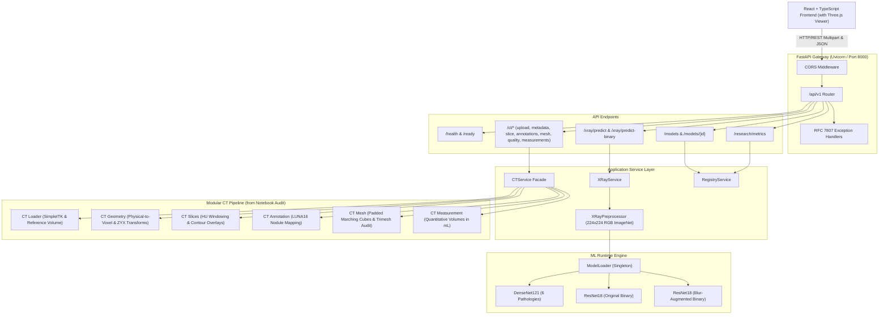

# LungVision AI Backend — Architecture & System Design

**Document Version:** 1.1.0  
**Status:** Implemented, Integrated & Verified  
**Author:** Staff Backend Architect & MLOps Lead  

---

## 1. System Topology

The LungVision AI Backend is an asynchronous microservice engineered with Python, FastAPI, and PyTorch, designed to decouple machine learning and 3D volumetric pipelines from client presentation layers.

---

## 2. Integrated 3D CT Architecture (Ported from Interactive Notebook)

The 3D CT exploration engine preserves the mathematical rigor of the interactive notebook (`lungvision-interactive-viewer.ipynb`):

1. **Geometry Engine (`geometry.py`):**
   - Implements tolerant floating-point comparison (`atol=1e-3`) between CT and segmentation masks.
   - Converts physical coordinates $\mathbf{p} = (X, Y, Z)$ to continuous voxel coordinates via $\mathbf{c} = \mathbf{D}^{-1}(\mathbf{p} - \mathbf{O}) \oslash \mathbf{S}$.
   - Transforms marching cubes ZYX vertices into physical millimeters via $\mathbf{P} = \mathbf{O} + \mathbf{D}(\mathbf{v}_{xyz} \odot \mathbf{S})$.
2. **Multi-Planar Slice Service (`slice_service.py`):**
   - Generates Axial ($Z$), Coronal ($Y$), and Sagittal ($X$) cross-sections.
   - Applies standard clinical Hounsfield Unit windowing (Lung: -600/1500, Mediastinum: 50/350, Bone: 400/1800).
   - Alpha-blends color contours for Left Lung (label 3), Right Lung (label 4), and Trachea (label 5).
   - Projects intersecting LUNA16 nodule markers onto the 2D slice plane.
3. **Nodule Annotation Service (`annotation_service.py`):**
   - Parses LUNA16 CSV manifests, checks volume bounds, and samples the center label.
4. **Watertight Mesh Service (`mesh_service.py`):**
   - Utilizes 1-voxel constant zero padding before marching cubes to guarantee watertight surface extraction at CT boundary borders.
   - Evaluates mesh topology using Trimesh (watertightness, winding consistency, Euler number, degenerate faces).
   - Streams standard Wavefront OBJ files for direct consumption by Three.js.
5. **Quantitative Measurement Service (`measurement_service.py`):**
   - Computes exact anatomical lung volume in milliliters ($V = N \times s_x s_y s_z / 1000$).
   - Calculates lung symmetry balance ratios and label distribution breakdowns.
