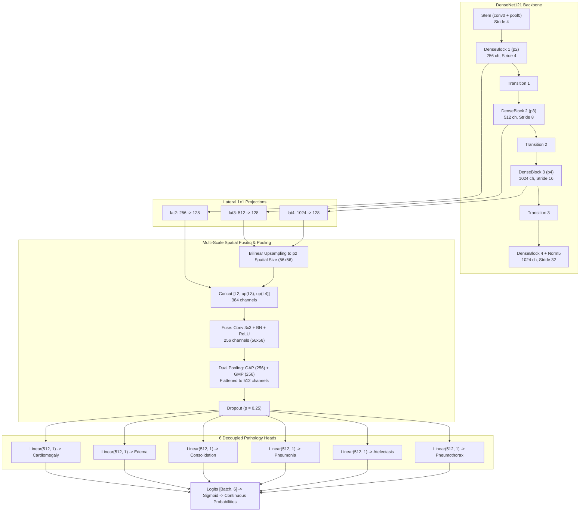
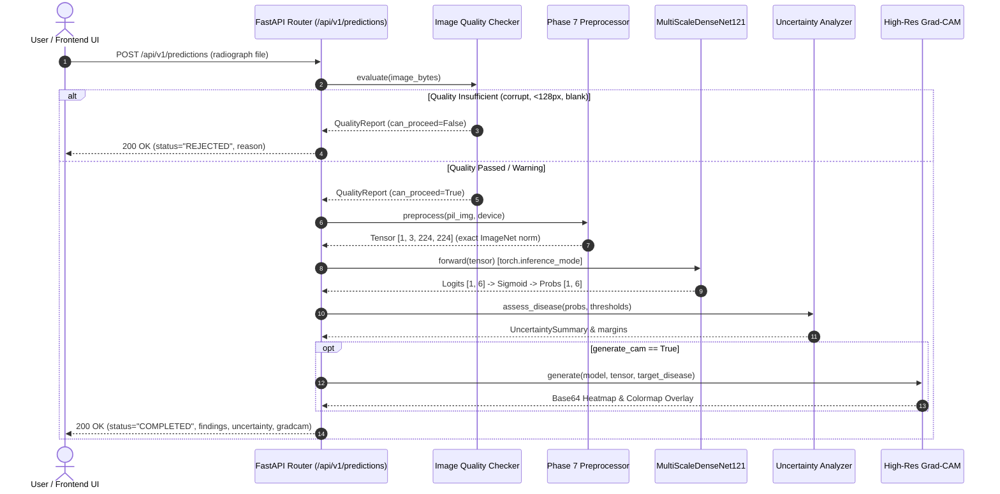

# LungVision AI — Phase 7 Model Integration & Architecture

## 1. System Overview

Phase 7 integrates the experimentally validated **MultiScaleDenseNet121** deep neural network into LungVision AI.

The integrated architecture provides multi-scale feature aggregation, combining fine spatial details from early dense blocks with semantic macroscopic context from late blocks.



---

## 2. Checkpoint Specifications & Integrity

- **Filename**: `msd121_224_weighted_bce_direct.pth`
- **Location**: `models/multiscale_densenet121/msd121_224_weighted_bce_direct.pth`
- **SHA-256**: `7dc735ee00d9e57ece14cd33f2bdbd1e7fd226adca41cdb692ba0af2a33a9b23`
- **Filesize**: 32,904,058 bytes (31.38 MB)
- **Trainable Parameters**: Exactly 8,071,942
- **Tensors in State Dict**: 749 tensors (100% verified finite, strict loading without missing or unexpected keys)
- **Validation Macro AUROC**: **0.819726** (Best performing candidate in Phase 7 recovery)

---

## 3. End-to-End Prediction Pipeline



---

## 4. Software Architecture Organization

```
backend/
├── app/
│   ├── models/
│   │   ├── multiscale_densenet.py     # Phase7MultiScaleDenseNet121 & legacy FPN
│   │   └── ...
│   ├── inference/
│   │   ├── preprocessing.py          # Exact direct 224 bilinear ImageNet preprocessor
│   │   ├── quality_checker.py        # Clinical decodability, blur & dynamic range checks
│   │   ├── calibration.py            # Operating Points A (F1), B (0.5), C (High-Sens)
│   │   ├── uncertainty.py            # Margin-based certainty & abstention recommendations
│   │   ├── gradcam.py                # 56x56 High-resolution fused Grad-CAM
│   │   └── prediction_engine.py      # Thread-safe singleton model inference engine
│   ├── services/
│   │   ├── registry_service.py       # Central model catalog & benchmark metrics
│   │   └── xray_service.py           # Multi-label & binary 2D screening coordinator
│   └── api/v1/
│       ├── predictions.py            # POST /predictions, GET /model/health, GET /model/info
│       └── xray.py                   # POST /xray/predict (supporting model_id)
```

---

## 5. Verification Matrix

| Verification Criterion | Method | Requirement | Observed Status |
|---|---|---|:---:|
| **Checkpoint Integrity** | SHA-256 calculation | `7dc735ee...` byte match | **PASSED** |
| **Model Architecture** | Strict state dict load | 8,071,942 parameters, 0 missing | **PASSED** |
| **Preprocessing Parity** | `torch.allclose` comparison | Max absolute diff $< 1\times 10^{-6}$ | **PASSED (diff = 0.0)** |
| **Quality Gate** | Ingestion boundary testing | Reject unreadable, $<128$, blank | **PASSED** |
| **Prediction Contract** | Shape & domain check | Output shape $[1, 6]$, probs $\in (0, 1)$ | **PASSED** |
| **Explainability** | Grad-CAM activation test | $56 \times 56$ feature map, base64 overlay | **PASSED** |
| **Regression Stability** | Pytest test suite | 159/159 tests passing | **PASSED** |
| **Frontend Integration** | Vitest & TypeScript build | 39/39 vitest passing, Vite build | **PASSED** |
