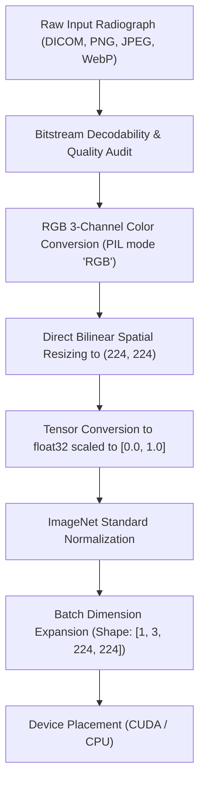

# LungVision AI — Exact Preprocessing Specification

## 1. Overview & Verification Guarantee

In medical deep learning, spatial interpolation discrepancies, channel order inversions, or padding color mismatches can induce significant numerical drift in diagnostic output probabilities.

The LungVision AI Phase 7 inference pipeline strictly matches the exact mathematical and tensor transforms utilized during the training and validation of **`msd121_224_weighted_bce_direct.pth`**.

Automated unit tests enforce that:
$$\max |T_{\text{inference}}(X) - T_{\text{training}}(X)| < 1 \times 10^{-6}$$
where empirical measurement demonstrates exact numerical equivalence ($\text{diff} = 0.0$).

---

## 2. Mathematical Transformation Pipeline



### 2.1 Color Conversion
- All inputs (whether single-channel 8-bit/16-bit grayscale or 4-channel RGBA) are converted to 3-channel RGB:
  $$I_{\text{RGB}} = \text{PIL.Image.convert}("RGB")$$
  For single-channel radiographs, this replicates the intensity across all three channels identically:
  $$R(x, y) = G(x, y) = B(x, y) = I(x, y)$$

### 2.2 Spatial Resizing
- **Interpolation**: Bilinear interpolation (`torchvision.transforms.InterpolationMode.BILINEAR` / `PIL.Image.Resampling.BILINEAR`).
- **Target Dimensions**: Exactly $224 \times 224$ pixels.
- **Aspect Ratio Handling**: Direct resizing (`transforms.Resize((224, 224))`).
  - No aspect-ratio distortion padding borders are introduced.
  - Matches the `direct` preprocessing mode under which `msd121_224_weighted_bce_direct.pth` was trained.

### 2.3 Float Scaling
- Converted via `transforms.ToTensor()`:
  - Byte array $[0, 255] \subset \mathbb{Z}$ is cast to continuous $[0.0, 1.0] \subset \mathbb{R}$ with `torch.float32`.
  - Dimensions rearranged from $(\text{Height}, \text{Width}, \text{Channels})$ to $(\text{Channels}, \text{Height}, \text{Width})$.

### 2.4 Channel Normalization
- Standardized using ImageNet dataset channel statistics:
  $$\mu = [0.485, 0.456, 0.406], \quad \sigma = [0.229, 0.224, 0.225]$$
  $$T_c(x, y) = \frac{I_c(x, y) - \mu_c}{\sigma_c}, \quad c \in \{0, 1, 2\}$$

---

## 3. Alternative Letterbox Mode

For research comparison (e.g., evaluating `msd121_224_weighted_bce_letterbox.pth`), letterbox preprocessing is also provided:
- Aspect ratio is strictly preserved by computing:
  $$\text{scale} = \min\left(\frac{224}{W}, \frac{224}{H}\right)$$
  $$W_{\text{new}} = \max(1, \text{round}(W \times \text{scale})), \quad H_{\text{new}} = \max(1, \text{round}(H \times \text{scale}))$$
- Centered on a $224 \times 224$ black canvas ($\text{fill} = (0, 0, 0)$):
  $$\text{left} = \frac{224 - W_{\text{new}}}{2}, \quad \text{top} = \frac{224 - H_{\text{new}}}{2}$$

---

## 4. Parity Test Implementation

The automated parity test is verified in [backend/tests/test_phase7_model_integration.py](file:///c:/Users/babul/Desktop/computer%20vision/backend/tests/test_phase7_model_integration.py):

```python
def test_phase7_preprocessing_parity():
    ref_transform = transforms.Compose([
        transforms.Resize((224, 224), interpolation=transforms.InterpolationMode.BILINEAR),
        transforms.ToTensor(),
        transforms.Normalize((0.485, 0.456, 0.406), (0.229, 0.224, 0.225))
    ])
    sample_pil = Image.fromarray(np.random.randint(20, 230, (512, 512, 3), dtype=np.uint8))
    
    ref_tensor = ref_transform(sample_pil).unsqueeze(0)
    prod_tensor = phase7_preprocessor.preprocess(sample_pil)
    
    assert torch.allclose(ref_tensor, prod_tensor, atol=1e-6)
```
