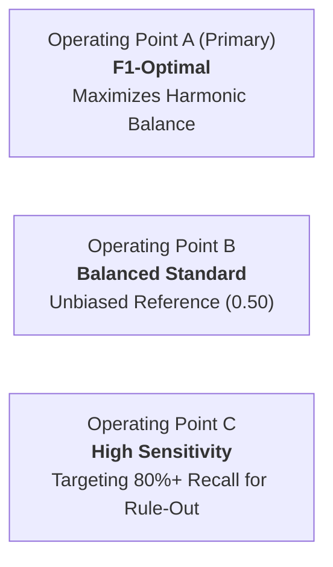

# LungVision AI — Calibrated Thresholds & Uncertainty Quantification

## 1. Threshold Optimization Methodology

In severe class-imbalance regimes such as chest radiograph screening (where true pathology prevalence ranges between 1.0% and 10.0%), a naïve threshold of 0.50 produces severe false-negative rates for rare pathologies and excessive false alarms for frequent ones.

Threshold calibration for Phase 7 MultiScaleDenseNet121 was derived strictly on the **13,501-radiograph validation split** of NIH ChestX-ray14. The held-out test split was kept strictly untouched.

---

## 2. Operating Points

LungVision AI provides three calibrated operating profiles:

### 2.1 Operating Point A: Validation F1-Optimal (Primary Enforced)

Optimizes the harmonic mean between precision and recall ($F_1 = \frac{2 \cdot P \cdot R}{P + R}$) on the validation cohort:

| Disease | Threshold ($\tau$) | Validation $F_1$ Score | Sensitivity | Specificity | Precision | Brier Score |
|---|:---:|:---:|:---:|:---:|:---:|:---:|
| **Cardiomegaly** | **0.87** | 0.2910 | 0.6778 | 0.8965 | 0.1178 | 0.0788 |
| **Edema** | **0.94** | 0.2243 | 0.7368 | 0.8554 | 0.0742 | 0.1033 |
| **Consolidation** | **0.79** | 0.1937 | 0.8153 | 0.6289 | 0.0695 | 0.2255 |
| **Pneumonia** | **0.55** | 0.0708 | 0.5252 | 0.8496 | 0.0351 | 0.1061 |
| **Atelectasis** | **0.67** | 0.3680 | 0.7539 | 0.6845 | 0.2091 | 0.1889 |
| **Pneumothorax** | **0.77** | 0.2466 | 0.5846 | 0.8452 | 0.1192 | 0.1173 |

### 2.2 Operating Point B: Balanced Standard (0.50 Unbiased)

Sets $\tau = 0.50$ across all 6 classes. Suitable for uncalibrated raw probability inspection.

### 2.3 Operating Point C: High-Sensitivity Screening

Optimized for emergency department triage and rapid rule-out:
- Cardiomegaly: 0.35
- Edema: 0.30
- Consolidation: 0.40
- Pneumonia: 0.30
- Atelectasis: 0.45
- Pneumothorax: 0.40

---

## 3. Probability Calibration Quality (Brier Scores)

Calibration measures whether predicted probabilities correspond to empirical frequencies of disease presence. The Brier score measures mean squared error between continuous predictions and binary ground truth:
$$\text{Brier} = \frac{1}{N} \sum_{i=1}^N (p_i - y_i)^2$$

- **Cardiomegaly**: 0.0788 (Well calibrated, low mean quadratic error)
- **Edema**: 0.1033
- **Consolidation**: 0.2255
- **Pneumonia**: 0.1061
- **Atelectasis**: 0.1889
- **Pneumothorax**: 0.1173

---

## 4. Margin-Based Uncertainty & Clinical Abstention

For each disease, the prediction engine computes the absolute margin to the active decision threshold:
$$\Delta = |p_i - \tau_i|$$

### 4.1 Confidence Categorization

| Condition | Classification | Clinical Interpretation | Action |
|---|---|---|---|
| $\Delta < 0.05$ | **BORDERLINE / UNCERTAIN** | Model score is in the immediate vicinity of the threshold | Flag for overread; do not rely on binary flag alone |
| $0.05 \le \Delta < 0.15$ | **LOW CONFIDENCE** | Mild separation from threshold | Clinical correlation recommended |
| $0.15 \le \Delta < 0.30$ | **MODERATE CONFIDENCE** | Reasonable separation from threshold | Standard reading workflow |
| $\Delta \ge 0.30$ | **HIGH CONFIDENCE** | Strong boundary separation | High-confidence prediction |

### 4.2 Abstention & Alert Recommendations

1. **`HIGH_ACUITY_ALERT`**: Triggered when acute conditions (Pneumothorax, Edema, Cardiomegaly) exceed the decision threshold with moderate or high confidence.
2. **`EXPERT_REVIEW_RECOMMENDED`**: Triggered when $\ge 2$ pathologies fall into the `BORDERLINE` margin, or if high-frequency image blur warnings were issued.
3. **`STANDARD_READING`**: Triggered when findings are clear of decision boundaries.
4. **`TECHNICAL_REPEAT_RECOMMENDED`**: Triggered when input radiograph fails clinical quality screening.
