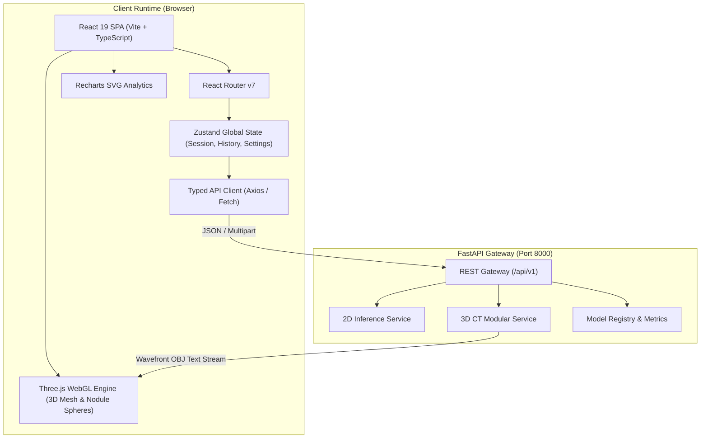
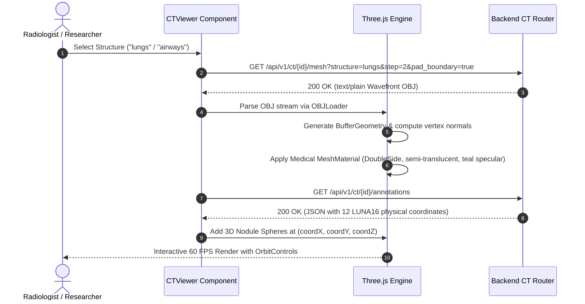

# LungVision AI — Frontend System Architecture Specification

**Document Version:** 1.0.0  
**Status:** Approved / Active Governance  
**Author:** Staff Frontend Architect & Medical UI/UX Lead  
**Governing Skill:** Gravitas Engineering Reliability Runtime  
**Created:** 2026-11-12  

---

## 1. System Topology & Architecture

The LungVision AI frontend is structured as a decoupled Single Page Application (SPA) communicating with the verified FastAPI backend over HTTP/REST JSON, multipart form data, and raw text streams.



---

## 2. Directory Structure & Modular Layout

```text
frontend/
├── project_governance/          # 6 Mandatory Governance Files (PRD, ARCH, RULES, etc.)
├── public/                      # Static assets, favicon, medical icons
├── src/
│   ├── assets/                  # CSS stylesheets, logo SVGs, illustrations
│   ├── components/              # Shared Reusable UI Components
│   │   ├── common/              # Button, Card, Badge, Modal, Tooltip, Alert, Spinner
│   │   ├── layout/              # Navbar, Sidebar, PageHeader, Footer, AppLayout
│   │   └── medical/             # ProbabilityBar, ThresholdMarker, PathologyBadge
│   ├── features/                # Domain-Driven Feature Modules
│   │   ├── dashboard/           # System status, model cards, quick navigation
│   │   ├── xray/                # 2D X-Ray upload, DenseNet121 & ResNet18 inference views
│   │   ├── ct/                  # 3D CT Explorer, MPR viewers, Three.js canvas, volumetry
│   │   ├── research/            # Benchmark analytics, AUROC/AUPRC Recharts
│   │   ├── models/              # Neural network registry inspection
│   │   ├── history/             # Session history tracker
│   │   └── settings/            # API base URL configuration & connectivity tests
│   ├── services/
│   │   └── api/                 # Typed API Clients
│   │       ├── client.ts        # Axios client instance with interceptors
│   │       ├── healthApi.ts     # /health, /ready probes
│   │       ├── xrayApi.ts       # /xray/predict, /xray/predict-binary
│   │       ├── ctApi.ts         # /ct/upload, /metadata, /slice, /mesh, /measurements
│   │       ├── modelApi.ts      # /models, /models/{id}
│   │       └── researchApi.ts   # /research/metrics
│   ├── store/                   # Zustand Stores
│   │   ├── useAppStore.ts       # Global status, active scan, notifications
│   │   └── useHistoryStore.ts   # Client-side session history
│   ├── types/                   # Strict TypeScript Interfaces matching Backend Schemas
│   │   ├── api.ts               # Standard API envelopes & RFC 7807 error formats
│   │   ├── xray.ts              # 2D prediction requests and multi-label responses
│   │   ├── ct.ts                # Volumetric dimensions, slices, annotations, meshes
│   │   └── models.ts            # Model registry entries and benchmark tables
│   ├── hooks/                   # Custom React Hooks
│   │   ├── useHealth.ts         # Periodic health probe polling
│   │   ├── useXrayPrediction.ts # Mutation hook for X-ray inference
│   │   └── useCTVolume.ts       # Volume metadata and slice fetchers
│   ├── App.tsx                  # Root application router setup
│   ├── main.tsx                 # Entrypoint, React DOM mounting
│   └── index.css                # Tailwind CSS imports and design tokens
├── tests/                       # Vitest & React Testing Library Suite
├── index.html                   # HTML entrypoint
├── package.json                 # Project dependencies & scripts
├── tsconfig.json                # Strict TypeScript configuration
├── vite.config.ts               # Vite configuration (port 5173, proxy, plugins)
└── tailwind.config.js           # Design tokens, medical palette, dark mode
```

---

## 3. Three.js Volumetric Rendering Pipeline

The 3D CT viewer renders anatomical thoracic meshes streamed directly from the FastAPI backend endpoint `GET /api/v1/ct/{scan_id}/mesh`.



### Memory & Resource Lifecycle
1. **Geometry & Material Disposal:** On unmounting or switching scans, all `BufferGeometry`, `MeshStandardMaterial`, and textures are explicitly disposed via `.dispose()`.
2. **Animation Loop Cancellation:** `requestAnimationFrame` IDs are cancelled on component unmount.
3. **Canvas Resizing:** `ResizeObserver` automatically updates aspect ratio and projection matrix.

---

## 4. Multi-Planar Reconstruction (MPR) Architecture

The MPR viewer displays 3 orthogonal synchronized 2D viewports:
- **Axial Viewport:** Traverses $Z$ axis (craniocaudal).
- **Coronal Viewport:** Traverses $Y$ axis (anteroposterior).
- **Sagittal Viewport:** Traverses $X$ axis (left-to-right).

Each viewport requests slice images from `GET /api/v1/ct/{id}/slice`:
- Ingestion of Base64-encoded PNG slices.
- Dynamic query parameter switching: `window=lung|mediastinum|bone`, `overlay_mask=true`, `show_nodules=true`.
- Real-time client-side rendering with overlay crosshairs and nodule hover tooltips.

---

## 5. Error Handling & Security Boundaries

1. **RFC 7807 Error Interception:** Standardized problem details (`code`, `message`, `timestamp`, `details`) parsed by the API client and rendered as contextual user-friendly alert banners.
2. **Network Resilience:** Automatic retry on transient network failures with exponential backoff.
3. **Client-Side File Validation:** Images and CT archives are checked for file size, extension, and magic headers before upload to prevent unnecessary network payload waste.
4. **Zero Client Secret Storage:** No API tokens or sensitive credentials embedded in client code.

