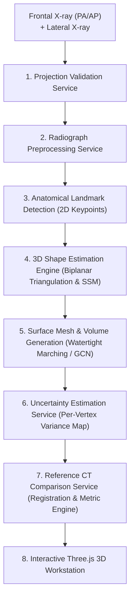

# LungVision AI — Baseline 3D Reconstruction Architecture Design

**Document Version:** 1.0.0  
**Architecture Standard:** Modular Decoupled Service-Oriented Pipeline  
**Lead Architect:** Principal Medical AI Product Architect & Senior Full-Stack Engineer  
**Status:** System Architecture Specification  
**Date:** 2026-11-13  

---

## 1. Executive Summary & Design Principles

This document specifies the end-to-end, modular system architecture for **bi-planar 3D lung reconstruction** in LungVision AI.

### Architectural Invariants
1. **Decoupled from 2D Classification:** The 3D reconstruction pipeline operates as an independent geometrical and spatial service (`backend/app/services/reconstruction/`). It is **strictly decoupled** from the existing DenseNet-121 6-disease classifier and ResNet-18 binary triage heads. Classification probabilities are never used as synthetic reconstruction supervision.
2. **Watertight Anatomical Constraints:** All mesh outputs must maintain closed 2-manifold topology ($\partial M = \emptyset$) with valid Euler characteristic ($\chi = 2$ per closed component) to guarantee non-intersecting lung boundaries.
3. **Explicit Uncertainty Quantification:** Because depth reconstruction from only two 2D projections is inherently ambiguous in retrocardiac and subdiaphragmatic regions, every reconstructed vertex carries an empirical uncertainty score ($0.00$ to $1.00$).

---

## 2. End-to-End Modular Pipeline



---

## 3. Module Specifications & Service Contracts

### Module 1: Projection Validation Service (`ProjectionValidatorService`)
* **Role:** Verifies that uploaded image pairs satisfy radiographic requirements for bi-planar reconstruction.
* **Checks Executed:**
  1. *Projection Verification:* Evaluates aspect ratio, orientation labels, and deep visual features to confirm Slot A is a Frontal projection (PA or AP) and Slot B is a Lateral projection (left or right).
  2. *Dimensional Sanity:* Ensures resolution is at least $512 \times 512$ pixels.
  3. *Exposure & Dynamic Range:* Rejects washed-out, severely underexposed, or corrupted non-radiographic files.
  4. *Pairing Plausibility:* Verifies patient anatomical height consistency between frontal thoracic height and lateral thoracic height within $\pm 12\%$.

### Module 2: Image Preprocessing Service (`ReconstructionPreprocessor`)
* **Role:** Transforms raw heterogeneous radiographs into standardized, scale-normalized tensors.
* **Pipeline:**
  1. 16-bit to float dynamic range normalization (or 8-bit standard scaling).
  2. Contrast Limited Adaptive Histogram Equalization (CLAHE, clip limit: $2.0$, tile grid: $8 \times 8$).
  3. Aspect-ratio preserving padding to square dimensions ($512 \times 512 \times 1$).
  4. Z-score normalization matching training DRR distribution ($\mu = 0.5, \sigma = 0.25$).

### Module 3: Anatomical Landmark Detection (`LandmarkDetectionService`)
* **Role:** Detects 16 anatomical keypoints across the two radiographic views using a high-resolution heatmap regression network (HRNet / U-Net).
* **Landmarks Detected:**
  - **Frontal View ($L_{PA}$):**
    1. Right Lung Apex ($x, y$)
    2. Left Lung Apex ($x, y$)
    3. Right Costophrenic Angle ($x, y$)
    4. Left Costophrenic Angle ($x, y$)
    5. Right Cardiophrenic Angle ($x, y$)
    6. Left Cardiophrenic Angle ($x, y$)
    7. Tracheal Carina ($x, y$)
    8. Aortic Arch Zenith ($x, y$)
    9. Highest Point of Right Hemidiaphragm ($x, y$)
    10. Highest Point of Left Hemidiaphragm ($x, y$)
  - **Lateral View ($L_{LAT}$):**
    11. Superior Sternum (Manubrium border)
    12. Inferior Sternum (Xiphisternal junction)
    13. Anterior Costophrenic Angle
    14. Posterior Costophrenic Angle
    15. Posterior Diaphragmatic Insertion
    16. Mid-Thoracic Vertebral Promontory

### Module 4: 3D Shape Estimation Engine (`ShapeEstimationService`)
* **Role:** Solves the 2D-to-3D spatial correspondence problem to establish the initial 3D anatomical scaffolding.
* **Algorithm:**
  1. *Epipolar Triangulation:* For corresponding landmarks sharing the same axial coordinate ($z$), compute physical depth $(x, y, z)$ based on known source-to-detector geometry.
  2. *Procrustes Alignment:* Perform rigid transformation (scale, rotation, translation) aligning a canonical mean thoracic lung model $\bar{\mathbf{S}}$ to the sparse 3D landmark scaffold.
  3. *Statistical Deformation:* Optimize PCA shape parameter vector $\mathbf{b} \in \mathbb{R}^k$ constrained by eigenvalues $\lambda_i$:
     $$\hat{\mathbf{b}} = \arg\min_{\mathbf{b}} \|\mathbf{K}_{\text{scaffold}} - \mathbf{M}_{\text{landmark}}(\bar{\mathbf{S}} + \mathbf{P}\mathbf{b})\|_2^2 + \gamma \sum_{i=1}^k \left(\frac{b_i}{\sqrt{\lambda_i}}\right)^2$$

### Module 5: Mesh & Volume Generation Service (`MeshGenerationService`)
* **Role:** Generates watertight surface meshes for Left Lung, Right Lung, and Airways, and constructs an optional discrete $128 \times 128 \times 128$ voxel density map.
* **Outputs:**
  - Watertight Wavefront OBJ streaming payload.
  - Voxelized organ label masks ($0$: background, $3$: left lung, $4$: right lung, $5$: airways).
  - Volumetric measurements (computed volume in $cm^3$, estimated lung capacity in $mL$).

### Module 6: Uncertainty Estimation Service (`UncertaintyService`)
* **Role:** Quantifies spatial confidence for every surface vertex.
* **Mechanism:**
  - Computes Monte Carlo ensemble variance across multiple deformation hypotheses or evaluates geometric distance from projection ray constraints.
  - Generates per-vertex uncertainty scalar field $u_v \in [0.0, 1.0]$.
  - Identifies anatomically ambiguous zones (e.g. retrocardiac space obscured on lateral view, subdiaphragmatic bases).

### Module 7: Reference CT Comparison Service (`CTComparisonService`)
* **Role:** Validates reconstructed 3D models against ground-truth or reference CT volumes when paired scans are available.
* **Metrics Computed:**
  - 3D Dice Similarity Coefficient ($DSC$)
  - Average Symmetric Surface Distance ($ASSD$ in mm)
  - 95th Percentile Hausdorff Distance ($HD95$ in mm)
  - Volume Estimation Error Percentage ($VEE\%$)
  - Landmark Localization Mean Error ($LLE$ in mm)

### Module 8: Interactive Visualization Service (`ThreeMeshStreamer`)
* **Role:** Streams 3D meshes, nodule annotations, and uncertainty color heatmaps to the React/Three.js frontend canvas.
* **Shader Attributes:**
  - Normal rendering, metallic-roughness PBR lighting.
  - Dynamic opacity sliders for left lung, right lung, and trachea.
  - Uncertainty heatmap mode (mapping vertex confidence to a viridis/turbo color ramp).

---

## 4. Backend Service Schemas (Pydantic / TypeScript Interfaces)

```python
# backend/app/schemas/reconstruction.py

from typing import List, Optional, Dict
from pydantic import BaseModel, Field

class Landmark2D(BaseModel):
    name: str
    x_pixel: float
    y_pixel: float
    confidence: float

class Landmark3D(BaseModel):
    name: str
    coord_xyz_mm: List[float] = Field(..., min_items=3, max_items=3)
    uncertainty_mm: float

class MeshVertex(BaseModel):
    x: float
    y: float
    z: float
    uncertainty: float = 0.0

class ReconstructionRequest(BaseModel):
    frontal_image_id: str
    lateral_image_id: str
    patient_sex: Optional[str] = "unknown"
    patient_height_cm: Optional[float] = None
    target_structures: List[str] = ["lungs", "left_lung", "right_lung", "airways"]
    output_resolution_mm: float = 2.0

class ReconstructionResponse(BaseModel):
    reconstruction_id: str
    status: str
    processing_time_ms: float
    mesh_obj_url: str
    volume_measurements: Dict[str, float]  # structure -> volume in cm3
    landmarks_3d: List[Landmark3D]
    mean_surface_uncertainty: float
    validation_status: str
    disclaimer: str
```

```typescript
// frontend/src/types/reconstruction.ts

export interface Landmark3D {
  name: string;
  coord_xyz_mm: [number, number, number];
  uncertainty_mm: number;
}

export interface 3DReconstructionResponse {
  reconstruction_id: string;
  status: 'completed' | 'failed' | 'fallback_template';
  processing_time_ms: number;
  mesh_obj_url: string;
  volume_measurements: {
    total_lung_cm3: number;
    left_lung_cm3: number;
    right_lung_cm3: number;
    airways_cm3: number;
  };
  landmarks_3d: Landmark3D[];
  mean_surface_uncertainty: number;
  disclaimer: string;
}
```

