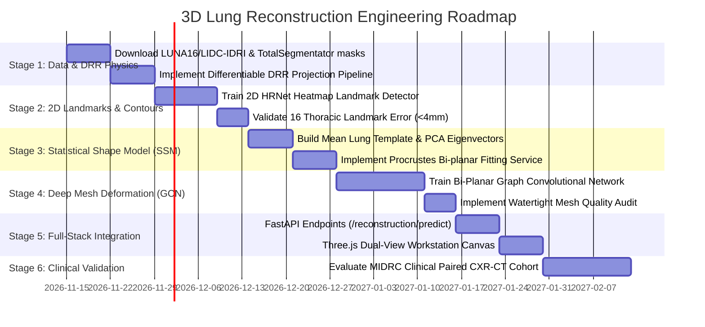

# LungVision AI — 3D Reconstruction Implementation & Execution Plan

**Document Version:** 1.0.0  
**Project Standard:** Gravitas Engineering Reliability Runtime  
**Lead Architect:** Principal Medical AI Product Architect & ML Infrastructure Engineer  
**Status:** Engineering Execution Roadmap  
**Date:** 2026-11-13  

---

## 1. Executive Roadmap & Phased Execution

This plan details the phased execution strategy to implement **patient-specific 3D lung reconstruction from bi-planar chest radiographs**, progressing safely from synthetic data preparation to clinical benchmark validation.

---

## 2. Stage-by-Stage Breakdown

### Stage 1: Data Acquisition & Differentiable DRR Pipeline
* **Objective:** Construct a calibrated dataset of 1,000+ paired Frontal (PA) and Lateral radiographs with registered ground-truth 3D thoracic CT volumes and lung masks.
* **Tasks:**
  1. Acquire $1,018$ thoracic CT volumes from TCIA LIDC-IDRI / LUNA16.
  2. Execute 3D TotalSegmentator to extract watertight ground-truth binary masks for left lung, right lung, and airways.
  3. Deploy PyTorch `DiffDRR` to generate ray-traced Frontal ($0^\circ$) and Lateral ($90^\circ$) projections ($SDD = 1800\text{ mm}$, detector pixel pitch: $0.35\text{ mm}$).
  4. Inject Poisson photon counting noise and flat-panel scatter simulation.
* **Deliverable:** `data/biplanar_drr_dataset/` ($1,018$ registered pairs with patient-disjoint train/val/test splits).

### Stage 2: 2D Anatomical Landmark & Contour Detection
* **Objective:** Accurately localize 16 thoracic anatomical keypoints and lung boundary silhouettes from 2D radiographs.
* **Tasks:**
  1. Train a high-resolution representation network (HRNet-W32) on frontal and lateral DRRs with heatmap regression loss.
  2. Evaluate Landmark Localization Error ($LLE$) on held-out test split, targeting $LLE \le 3.5\text{ mm}$.
  3. Extract continuous 2D boundary polygons for lung contours.
* **Deliverable:** `backend/app/services/reconstruction/landmark_service.py` & model checkpoint `hrnet_cxr_landmarks.pth`.

### Stage 3: Statistical Shape Model (SSM) & Procrustes Fitting
* **Objective:** Deploy a baseline, computationally lightweight 3D shape reconstruction engine.
* **Tasks:**
  1. Perform Generalized Procrustes Analysis (GPA) across 150 training CT lung surface meshes to build canonical mean lung template $\bar{\mathbf{S}}$ ($5,000$ vertices per lung).
  2. Compute covariance matrix eigenvectors and retain the top $k = 25$ principal modes (capturing $> 95\%$ of anatomical population variance).
  3. Implement bounded optimization finding shape parameters $\mathbf{b}$ that minimize 2D projected contour distance.
* **Deliverable:** `backend/app/services/reconstruction/ssm_service.py` delivering instant ($< 50\text{ ms}$) watertight 3D lung meshes on CPU.

### Stage 4: Bi-Planar Deep Mesh Deformation (Graph Convolutional Network)
* **Objective:** Enhance the baseline SSM to capture patient-specific asymmetrical pathologies and volume reductions.
* **Tasks:**
  1. Build a dual-view ResNet/ConvNeXt feature extractor producing aligned multi-scale feature pyramids.
  2. Implement Graph Convolutional Network (GCN) mesh deformation layers that iteratively displace template vertices:
     $$\mathbf{v}^{(l+1)} = \mathbf{v}^{(l)} + \text{GCN}\left(\text{Concat}(\mathbf{v}^{(l)}, \mathbf{f}_{\text{projected}})\right)$$
  3. Supervise with Chamfer distance, surface normal cosine loss, and Laplacian mesh smoothness regularization ($\mathcal{L}_{\text{Laplacian}}$).
* **Deliverable:** Checkpoint `biplanar_gcn_mesh_best.pth` achieving target $\text{DSC} \ge 0.88$ on held-out DRR test split.

### Stage 5: Full-Stack Integration & Interactive Workstation
* **Objective:** Seamlessly integrate the 3D reconstruction engine into LungVision AI's existing FastAPI backend and React frontend.
* **Tasks:**
  1. Author FastAPI endpoint `POST /api/v1/reconstruction/predict` accepting frontal and lateral image uploads.
  2. Stream generated Wavefront OBJ surface meshes and uncertainty vertex colors via `backend/app/services/reconstruction/`.
  3. Connect the frontend Dual-View X-Ray Research Lab (`/dual-view`) to the reconstruction endpoint.
  4. Render reconstructed 3D lungs in the Three.js canvas with anatomical structure toggles (Left Lung, Right Lung, Airways) and uncertainty heatmap visualization.
* **Deliverable:** End-to-end interactive 3D reconstruction workspace operating at 60 FPS in browser WebGL.

### Stage 6: External Clinical Validation
* **Objective:** Validate real-world generalization on authentic hospital patient cohorts with matched CXR and CT studies.
* **Tasks:**
  1. Acquire de-identified paired studies from the MIDRC repository ($N = 150$ subjects with same-day CXR and thoracic CT).
  2. Benchmark against ground-truth CT segmentations: Dice overlap ($DSC$), Average Symmetric Surface Distance ($ASSD$), 95th Percentile Hausdorff Distance ($HD95$), and Volume Estimation Error ($VEE\%$).
  3. Publish comprehensive clinical validation whitepaper.
* **Deliverable:** `docs/CLINICAL_3D_VALIDATION_REPORT.md`.

---

## 3. Resource Requirements & Risk Mitigation

| Component | Hardware / Software | Estimated Budget / Compute | Risk Mitigation Strategy |
| :--- | :--- | :--- | :--- |
| **Stage 1 (DRRs)** | PyTorch, SimpleITK, DiffDRR | $1\times \text{NVIDIA RTX 4090}$ ($18\text{ h}$) | Ray-batching and float16 precision to avoid GPU out-of-memory errors. |
| **Stage 2 (Landmarks)** | HRNet, Albumentations | $1\times \text{GPU}$ ($8\text{ h}$) | Geometric data augmentations (rotation $\pm 10^\circ$, scaling $0.9\text{--}1.1$). |
| **Stage 3 (SSM)** | Trimesh, SciPy, NumPy | CPU only ($< 1\text{ h}$) | Eigenvalue clamping ($\pm 3\sqrt{\lambda_i}$) prevents non-anatomical self-intersections. |
| **Stage 4 (GCN Mesh)** | PyTorch Geometric, PyTorch3D | $1\times \text{GPU}$ ($24\text{ h}$) | Strong Laplacian loss ($\lambda = 0.1$) guarantees smooth manifold curvature. |
| **Stage 5 (Frontend)** | React 18, Three.js, Vite | Client-side WebGL | BufferGeometry indexing with vertex cache optimization. |

