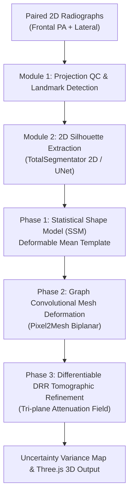

# 3D Lung Reconstruction from Bi-Planar Chest Radiographs: Comparative Method Feasibility Study

**Document Version:** 1.0.0  
**Research Standard:** Gravitas Engineering Reliability Runtime  
**Lead Author:** Senior Medical Imaging Scientist & Deep Learning Researcher  
**Status:** Methodological Literature Review & Comparative Analysis  
**Date:** 2026-11-13  

---

## 1. Executive Summary

Reconstructing a patient-specific 3D anatomical model or volumetric computed tomography (CT) scan from sparse 2D radiographic projections is an ill-posed inverse problem. A single chest radiograph integrates continuous three-dimensional attenuation into a 2D line-integral:

$$I(\mathbf{u}) = I_0 \exp\left(-\int_{L(\mathbf{u})} \mu(\mathbf{x}) \, ds\right)$$

With only two orthogonal projections (Frontal $0^\circ$ and Lateral $90^\circ$), the linear Radon transform is severely under-determined by several orders of magnitude ($\approx 2 \times 512^2 \approx 5.2 \times 10^5$ measurements vs. $128^3 \approx 2.1 \times 10^6$ unknown voxels or $256^3 \approx 1.68 \times 10^7$ voxels).

To overcome this ill-posedness, strong prior regularizations are mandatory. This study compares the five prominent research paradigms in medical computer vision:
1. **Statistical Shape Models (SSM)**
2. **Biplanar Deep Anatomical Mesh / Voxel Reconstruction**
3. **Differentiable Digitally Reconstructed Radiographs (Diff-DRR) Inverse Optimization**
4. **Conditional 3D Generative Diffusion Models**
5. **Neural Implicit Representations (NeRF / Tri-Plane Fields)**

---

## 2. Exhaustive Method Comparison Matrix

| Paradigm | Primary Input Requirements | Supervision & Training Data | Training Compute & Hardware | Inference Latency & Runtime | Clinical / Anatomical Limitations | Key Citations & Benchmarks |
| :--- | :--- | :--- | :--- | :--- | :--- | :--- |
| **1. Statistical Shape Models (SSM)** | 2D Frontal + Lateral segmentations / contours | Pre-segmented 3D training meshes ($N \approx 50\text{--}200$) | Very Low (CPU-only PCA decomposition, $< 1\text{ h}$) | **Ultra-Fast** ($< 50\text{ ms}$ on standard CPU) | Reconstructs surface meshes only (no internal CT Hounsfield Units). Linear PCA cannot model non-linear local tumors, severe atelectatic collapse, or post-surgical lung resections. | Cootes et al. (1995) *CVIU*; Heimann & Meinzer (2009) *MedIA*; van Rikxoort et al. (2009) *IEEE TMI*. |
| **2. Biplanar Deep Neural Reconstruction (CNN/Transformer)** | Paired 2D Frontal + Lateral radiographs | Fully supervised paired 2D-3D datasets or large-scale DRRs ($N \ge 1,000$) | Moderate ($1\text{--}2\text{ GPUs}$, $12\text{--}24\text{ h}$) | **Fast** ($100\text{--}300\text{ ms}$ on GPU, $2\text{--}4\text{ s}$ on CPU) | Tendency toward over-smoothing in voxel space (low-frequency bias of L1/L2 loss). High sensitivity to patient positioning and arm elevation between frontal and lateral acquisitions. | Ying et al. (2019) *X23D / MICCAI*; Henzler et al. (2018) *CVPR*; Peng et al. (2020) *Pixel2Mesh / ECCV*; Wu et al. (2022) *IEEE TBME*. |
| **3. Differentiable DRR Inverse Optimization (Diff-DRR)** | Calibrated Frontal + Lateral radiographs + camera geometry | Self-supervised projection loss; optionally zero training data if optimizing per-case | High per-case optimization ($5\text{--}15\text{ min}$ on GPU per patient) | **Slow** (Iterative gradient descent per study, no real-time inference) | Extremely vulnerable to local minima; requires exact knowledge of source-to-detector distance ($SDD$) and tube rotation angles. Reconstructed CTs exhibit line-streak artifacts. | Shen et al. (2019) *IEEE TMI*; Kaji et al. (2021) *Differentiable Tomography*; Gopalakrishnan et al. (2022) *DiffDRR / arXiv:2208.06432*. |
| **4. Conditional 3D Generative Models (Diffusion / GANs)** | Frontal + Lateral radiograph embeddings | Large-scale 3D CT volumes ($N \ge 2,500$ scans) for generative prior | **Extreme** ($4\text{--}8\times \text{A100 GPUs}$, $72\text{--}120\text{ h}$) | **Moderate to Slow** ($5\text{--}30\text{ s}$ for 50-step reverse diffusion sampling) | **Hallucination Risk:** Generative diffusion models can synthesize plausible-looking pulmonary nodules, vascular arborizations, or interstitial infiltrates that do not exist in the patient's actual anatomy. | Wolleb et al. (2022) *Diffusion Models for Medical Anomaly Detection / CVPR*; Wang et al. (2023) *3D-MedDiffusion*; Rombach et al. (2022) *LDM / CVPR*. |
| **5. Neural Implicit Representations & NeRFs (Tri-Plane / PixelNeRF)** | Frontal + Lateral radiographs + camera ray coordinates | Self-supervised projection rendering + categorical CT prior ($N \ge 500$) | High ($2\text{--}4\times \text{GPUs}$, $24\text{--}48\text{ h}$) | **Interactive** ($0.5\text{--}1.5\text{ s}$ with Tri-plane caching) | Severe depth ambiguity along ray integrals from only 2 views unless constrained by a strong categorical shape prior; can produce "floaters" in unconstrained thoracic regions. | Mildenhall et al. (2020) *NeRF / ECCV*; Corona-Figueroa et al. (2022) *MedNeRF / MedIA*; Yu et al. (2021) *PixelNeRF / CVPR*; Killeen et al. (2023) *CoNeRF*. |

---

## 3. Deep-Dive Paradigm Analysis

### 3.1 Statistical Shape Models (SSM)
Statistical Shape Models represent a 3D organ boundary as a set of $M$ corresponding boundary vertices:

$$\mathbf{S} = [\mathbf{x}_1^T, \mathbf{x}_2^T, \dots, \mathbf{x}_M^T]^T \in \mathbb{R}^{3M}$$

By performing Principal Component Analysis (PCA) on aligned training segmentations, the shape space is parameterized as:

$$\mathbf{S} = \bar{\mathbf{S}} + \mathbf{P} \mathbf{b} = \bar{\mathbf{S}} + \sum_{i=1}^{k} b_i \mathbf{p}_i$$

where $\bar{\mathbf{S}}$ is the mean thoracic shape, $\mathbf{P} \in \mathbb{R}^{3M \times k}$ are the eigenvectors of the covariance matrix, and $\mathbf{b} \in \mathbb{R}^k$ are shape parameters bounded by $\pm 3 \sqrt{\lambda_i}$.

* **Fitting Process:** 2D lung silhouettes and anatomical landmarks (apices, costophrenic angles, diaphragm domes) are extracted from Frontal and Lateral radiographs. Parameter vector $\mathbf{b}$ is optimized to minimize the 2D contour projection distance:
  $$\hat{\mathbf{b}} = \arg\min_{\mathbf{b}} \sum_{v \in \{PA, LAT\}} \mathcal{D}\left(\Pi_v(\mathbf{S}(\mathbf{b})), \mathbf{C}_v\right) + \sum_{i=1}^k \frac{b_i^2}{\lambda_i}$$
* **Verdict for LungVision AI:** **Optimal candidate for Phase 1.** Guaranteed watertight manifold topology, non-intersecting lung boundaries, zero hallucination risk, and instant real-time CPU rendering.

### 3.2 Biplanar Deep Neural Reconstruction (X23D / Graph Convolutions)
Recent deep learning approaches employ a dual-encoder architecture:
1. **Frontal Encoder:** ResNet / ConvNeXt extracting multi-scale 2D features $\mathbf{F}_{PA}$.
2. **Lateral Encoder:** Matching encoder extracting lateral features $\mathbf{F}_{LAT}$.
3. **Cross-Attention Fusion:** Orthogonal spatial feature aggregation where each voxel in a canonical 3D grid queries corresponding epipolar lines in $\mathbf{F}_{PA}$ and $\mathbf{F}_{LAT}$.
4. **Decoder:** Either a 3D U-Net producing a voxelized segmentation map ($128 \times 128 \times 128$) or a Graph Convolutional Network (GCN) deforming an initial spherical or template mesh directly into the lung surface (Pixel2Mesh paradigm).

* **Loss Function:**
  $$\mathcal{L} = \mathcal{L}_{\text{Dice}}(\hat{\mathbf{M}}, \mathbf{M}) + \alpha \mathcal{L}_{\text{Chamfer}}(\hat{\mathbf{V}}, \mathbf{V}) + \beta \mathcal{L}_{\text{Laplacian}}(\hat{\mathbf{V}})$$
  The Laplacian regularization term $\mathcal{L}_{\text{Laplacian}}$ prevents self-intersecting faces and enforces smooth anatomical curvature.
* **Verdict for LungVision AI:** **Recommended as Phase 2 Core Architecture.** Combines the geometric expressiveness of deep features with bounded deformable mesh outputs.

### 3.3 Neural Radiance Fields & Implicit Representations (NeRF / MedNeRF)
MedNeRF (Corona-Figueroa et al., 2022) adapts NeRF to reconstruct 3D attenuation fields $\mu(x,y,z)$ from few X-ray projections. Instead of RGB color and opacity, the neural network outputs Hounsfield Unit density:

$$f_\theta: (x, y, z) \mapsto \mu \in \mathbb{R}$$

Rays are marched through the volume according to the camera projection geometry, and pixel transmission is computed via discrete numerical quadrature:

$$\hat{C}(r) = \sum_{i=1}^N T_i \left(1 - \exp(-\mu_i \delta_i)\right), \quad T_i = \exp\left(-\sum_{j=1}^{i-1} \mu_j \delta_j\right)$$

* **The Bi-Planar Challenge:** Standard NeRF requires dozens to hundreds of views. When restricted to only 2 views ($0^\circ$ and $90^\circ$), coordinate MLPs fail completely without a generalizable multi-view feature backbone (e.g. PixelNeRF or Tri-plane NeRF). A tri-plane representation projects features onto three orthogonal feature planes ($XY, XZ, YZ$), which matches bi-planar acquisition geometry naturally.
* **Verdict for LungVision AI:** **High Potential for Phase 3 Research.** Can synthesize true tomographic slices (CT HU) rather than only surface meshes, but requires rigorous hallucination auditing.

---

## 4. Recommended Research Strategy: Phased Hybrid Architecture

Rather than attempting an end-to-end unconstrained NeRF or diffusion model in isolation, LungVision AI should adopt a **phased hybrid pipeline**:

1. **Phase 1 (Anatomical Scaffolding):** Statistical Shape Model + Landmark-guided Procrustes fitting. Delivers immediate, robust, non-intersecting 3D surface meshes for left lung, right lung, and airways.
2. **Phase 2 (Pathological Deformation):** Graph Convolutional Network (GCN) deforming mesh vertices to match subtle asymmetrical opacities and pleural effusions observed on 2D films.
3. **Phase 3 (Tomographic Synthesis):** Tri-plane NeRF initialized with the Phase 2 boundary prior, synthesizing internal continuous Hounsfield Unit attenuation.

