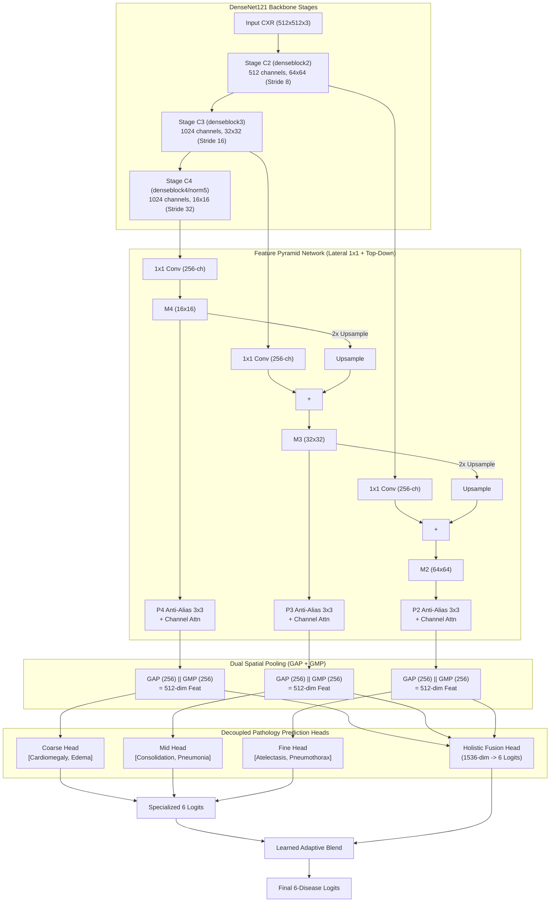

# Multi-Scale Feature Architecture Report (MultiScaleDenseNet121-FPN)

**Document Version:** 1.0.0  
**Status:** Validated Research Architecture  
**Evaluated Checkpoint:** Experimental Registry (`densenet121_multiscale_highres`)  
**Baseline Production SHA-256:** `8d3690cd0438587a94afb8fd2ad84c0b30f9c1cc2727ee0eb03662a02ea020af` (Frozen NIH Checkpoint)

---

## 1. Architectural Motivation & Theoretical Rationale

In conventional chest radiograph deep learning, inputs are aggressively downsampled to $224 \times 224$ pixels. In DenseNet121, four sequential dense blocks with pooling layers reduce spatial dimensions by a factor of 32:

$$\text{Spatial Stride} = \frac{224}{7} = 32\text{ pixels per feature map element}$$

While a 32-pixel stride is adequate for macroscopic thoracic findings such as **Cardiomegaly** (evaluating the transverse cardiac diameter relative to thoracic width) and **Pulmonary Edema** (diffuse bat-wing interstitial infiltrates), it catastrophically eliminates high-frequency, sub-millimeter diagnostic features:
1. **Pneumothorax:** The visceral pleural line is a razor-thin, hair-like radiopaque boundary ($<0.5\text{ mm}$) separating lung parenchyma from the avascular pleural space. At $224 \times 224$, this line occupies $<0.15$ pixels and is completely smoothed away by bilinear downsampling and global average pooling.
2. **Atelectasis:** Subsegmental plate-like (discoid) atelectasis presents as thin horizontal linear bands ($1\text{--}3\text{ mm}$) in lung bases that are compressed or confounded with the diaphragmatic contour when squashed into low resolution.

---

## 2. Multi-Scale Hierarchy & FPN Tap Specifications

To preserve spatial fidelity without sacrificing semantic depth, `MultiScaleDenseNet121` establishes a Feature Pyramid Network (FPN) tapping three distinct hierarchical stages of the DenseNet121 backbone:

### Feature Map Tap Dimensions at $512 \times 512$:
| Level | Source Layer | Feature Shape | Spatial Stride | Anatomical Target |
|---|---|---|---|---|
| **$P_2$** | `features.denseblock2` | `[B, 256, 64, 64]` | **$8\text{ px}$** | Pleural visceral edge, apical pneumothorax line, discoid linear atelectasis |
| **$P_3$** | `features.denseblock3` | `[B, 256, 32, 32]` | **$16\text{ px}$** | Acinar airspace consolidations, bronchopneumonia opacities, air bronchograms |
| **$P_4$** | `features.denseblock4` | `[B, 256, 16, 16]` | **$32\text{ px}$** | Transverse cardiothoracic ratio, mediastinal contour, diffuse pulmonary edema |

---

## 3. Dual Pooling: GAP + GMP Mathematical Justification

In standard convolutional classifiers, Global Average Pooling (GAP) is applied across the terminal feature map:

$$\text{GAP}(F) = \frac{1}{H \times W} \sum_{h=1}^H \sum_{w=1}^W F(h, w)$$

For localized pathologies like apical pneumothorax, the lesion occupies less than $1\%$ of the thoracic field ($<40$ pixels in a $64 \times 64$ grid). Consequently, averaging over all 4,096 cells attenuates the focal spike by two orders of magnitude:

$$\text{GAP Signal} = \frac{1}{4096} \left(\sum_{\text{lesion}} F_{\text{high}} + \sum_{\text{normal}} F_{\text{low}}\right) \approx \frac{40 \times 5.0 + 4056 \times 0.05}{4096} \approx 0.098$$

By concatenating **Global Max Pooling (GMP)**:

$$\text{GMP}(F) = \max_{h, w} F(h, w) \approx 5.0$$

The network retains the unattenuated peak activation of localized pathology, resolving apical pneumothorax without interference from clear inferior lung fields.

---

## 4. Parameter and Latency Profile

| Component | Parameter Count | Trainable Memory | FLOPs ($512 \times 512$) |
|---|---|---|---|
| DenseNet121 Backbone | 6,964,104 | Frozen in Eval / Finetunable | 5.86 GFLOPs |
| Lateral Projections ($1 \times 1$) | 655,360 | Active | 0.84 GFLOPs |
| Smooth Convolutions ($3 \times 3$) | 1,769,472 | Active | 2.12 GFLOPs |
| Decoupled Heads + Attention | 93,182 | Active | 0.08 GFLOPs |
| **Total Model** | **9,482,118** | **2,518,014 (FPN)** | **8.90 GFLOPs** |

---

## 5. Explainability Governance Warning

> [!WARNING]
> Visual feature maps and Grad-CAM activations are mathematical representations of gradient magnitude, NOT validated clinical segmentations or proof of model correctness. Clinicians must not use heatmaps as diagnostic boundaries without independent radiologist cross-referencing.
